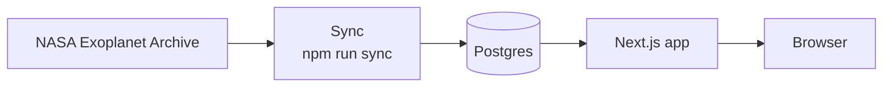

# ExoAtlas

A reference for every known exoplanet: searchable, with a page, a turning image and a 3D model for each planet, and a map of the Milky Way to fly through.

The data comes from the [NASA Exoplanet Archive](https://exoplanetarchive.ipac.caltech.edu/). Our own solar system is included.

## Status

Working today:

- Postgres database with schema and migrations
- Sync with NASA: 6,470 planets around 4,862 stars (as of November 14, 2026)
- The Sun and the eight planets of the solar system
- Search for planets and stars, with suggestions while typing and tolerance for typos
- A list of all planets, one per row, sorted by name or by year of discovery, 200 per page, with a field that filters it by name
- A page for each planet and each star, including the history of changed values and redirects from former names
- A turning, lit image for each planet in every list, and a 3D model on its page that can be turned by hand and zoomed into
- Real surface maps for the planets of the solar system, with Earth's clouds and city lights and Saturn's rings
- A map of the Milky Way to fly through: 4,835 stars at their measured positions, and every system with its planets on their orbits in 3D
- A legal notice and a privacy policy, which name whoever runs the copy

Ready for hosting on Vercel, with a daily sync, weekly backups and a read-only database role for the site: see [docs/DEPLOYMENT.md](docs/DEPLOYMENT.md).

## What it does

**Search.** By planet or star, tolerant of typos and spelling (`kepler 22b` finds `Kepler-22 b`).

**A list of all planets.** Every known planet, one per row, 200 per page, with a field that narrows the list while you type. The list is sorted by name or by year of discovery, newest first. Each row shows a plain image, the name, the star and the year of discovery, so the long list stays light.

**A page for each planet.** Measured values, star, discovery and the history of changes. Every value says whether it was measured or only calculated by NASA. For almost half of all planets, for example, the mass is only calculated.

**An image and a 3D model for each planet.** Almost no exoplanet has ever been photographed. Image and model are therefore computed from the measured values: size, planet class, temperature and the colour of the star decide the look. The page says clearly that it is an illustration, not a photograph. The planets of the solar system show real surface maps.

**A map of the Milky Way.** You fly through it freely. Near the Sun the background is a real photograph of the whole sky. From far away the galaxy is a computed model, because no photograph of it from outside exists. You can visit every system with known planets and the solar system, but not the remaining stars. That is 4,834 systems with a known distance. 28 more have none and only appear in the search.

## How it is built

Three parts:



- **Postgres** holds all data. Locally it runs in Docker.
- **The sync** is a script. It fetches the catalogue, compares it with the database and writes only the differences.
- **The app** (Next.js) reads straight from the database. It never writes. The planets and the map are drawn in the browser with WebGL.

| Area | Technology |
| --- | --- |
| App | Next.js 16, React 19, TypeScript, Tailwind 4 |
| Database | Postgres 17 with `pg_trgm` for the search |
| Database access | Drizzle ORM, migrations with drizzle-kit |
| Tests | Vitest |
| Planet images and 3D models | WebGL 2 with our own shaders |
| Map | three.js |

[docs/ARCHITECTURE.md](docs/ARCHITECTURE.md) explains the data flow, the database, the sync, the search, the images, the map and the code layout in detail.

### Code layout

Every feature lives in its own folder inside `src/app/`, with its pages, components, queries, logic and tests in one place.

| Folder | Content |
| --- | --- |
| [src/app/planets/](src/app/planets/) | The list of all planets, planet pages, classification, images and 3D models |
| [src/app/map/](src/app/map/) | The map of the Milky Way and the 3D view of a system |
| [src/app/stars/](src/app/stars/) | Star pages, sky coordinates |
| [src/app/search/](src/app/search/) | Search page, suggestions, search field |
| [src/app/catalog/](src/app/catalog/) | Numbers and featured planets on the start page |
| [src/app/legal/](src/app/legal/) | Legal notice and privacy policy |
| [src/app/sync/](src/app/sync/) | The comparison with NASA |
| [src/app/solar-system/](src/app/solar-system/) | The Sun and its planets |
| [src/db/](src/db/) | Schema and database connection |
| [src/shared/](src/shared/) | Helpers used by several features |
| [scripts/](scripts/) | Command line entry points for sync, seed and textures |
| [public/textures/](public/textures/) | Surface maps of the solar system and the panorama of the sky |

## Run it locally

Requirements: Node.js 24 and Docker.

```bash
npm install
cp .env.example .env.local
npm run db:up        # start Postgres in Docker
npm run db:migrate   # create the tables
npm run seed:sol     # store the solar system
npm run sync         # fetch the catalogue from NASA, takes a few seconds
npm run dev          # http://localhost:3000
```

### Before you put a copy online

The legal notice (`/legal/notice`) and the privacy policy (`/legal/privacy`) must name the person who runs the website. Set `LEGAL_NAME`, `LEGAL_STREET`, `LEGAL_CITY` and `LEGAL_EMAIL` in `.env.local` before `npm run build`; [.env.example](.env.example) lists them with the optional ones. As long as one is missing, both pages say that they are not complete.

The privacy policy describes what this code does: no cookies, no statistics, nothing loaded from other servers. What your hosting adds, such as its own log files, is yours to check, and so is the wording itself. The two pages are a careful draft, not legal advice.

[docs/DEPLOYMENT.md](docs/DEPLOYMENT.md) describes hosting on Vercel step by step: database, environment variables, migrations, the daily sync and what the legal pages need.

More commands:

| Command | Purpose |
| --- | --- |
| `npm test` | Unit tests, no database needed |
| `npm run test:db` | Tests against PostgreSQL; needs `npm run db:up`, uses its own database `exoatlas_test` |
| `npm run test:e2e` | Browser tests with Playwright: user flows, security, accessibility; builds the app and uses its own database `exoatlas_e2e`. Once before: `npm run e2e:install` |
| `npm run test:all` | All tests |
| `npm run test:smoke` | Smoke test against a running deployment: `SMOKE_BASE_URL=https://… npm run test:smoke`. Runs by itself after every Vercel deployment |
| `npm run deploy:rollback` | Put the previous production deployment back live; the deployment check runs it when the smoke test of production fails |
| `npm run typecheck` | Type check |
| `npm run lint` | ESLint |
| `npm run build` | Production build, also works without a database |
| `npm run db:generate` | Create a migration from a schema change |
| `npm run db:migrate-on-deploy` | Migrate during a Vercel production build; does nothing elsewhere |
| `npm run db:readonly-role` | Create the read-only database role for the site, or give it a new password ([DEPLOYMENT.md](docs/DEPLOYMENT.md)) |
| `npm run sync -- --force` | Sync even when the response from NASA looks implausible |
| `npm run textures` | Download the surface maps and the sky panorama again and scale them down. Only needed when a source or a size changes; the results are in the repository |

## Roadmap

1. **Foundation** (done): database, sync, solar system, start page, tests.
2. **Search and pages** (done): search with `pg_trgm`, a list of all planets, a page for each planet and star, redirects from former names, history of changes, an SVG image for each planet computed from its values.
3. **3D models** (done): turning images and a 3D model per planet, computed in a shader from planet class, climate class and the light of the star, with more detail when zooming in and real maps for the solar system.
4. **Map** (done): the Milky Way, free flight, jumping into a system and from there to a planet.
5. **Publishing** (done): hosting on Vercel, a daily sync and weekly backups with GitHub Actions, a read-only database role for the site and a rate limit on the search ([docs/DEPLOYMENT.md](docs/DEPLOYMENT.md)).

### What is real on the map and what is not

Real:

- The positions of the stars, calculated from their measured direction and distance.
- The colours of the stars, from their surface temperature.
- The sky near the Sun: a photograph of the whole Milky Way as seen from Earth.
- The surfaces of the planets of the solar system.
- The order of the orbits, their shape (eccentricity) and which planet runs faster.

A model or an illustration:

- The galaxy seen from outside: a bar, a bulge, a disc and four spiral arms, drawn as 110,000 points of light. No photograph of the Milky Way from outside exists.
- The surfaces of exoplanets. They are computed from planet class, climate class and the colour of the star.
- Sizes and distances inside a system. At true scale the planets would be invisible next to their orbits, so the distances are squeezed and the planets enlarged.
- The direction of each orbit and where on it a planet is right now. The catalogue does not say, so both are fixed at random per planet. All orbits lie in one plane.

### Left out on purpose

- Stars without known planets. A complete star catalogue would multiply the amount of data and would first have to be matched with the NASA data.
- The complete NASA row with more than 700 columns. The planet page links to the archive instead.
- The choice of a host. Options are a database service plus an app host, or a small server of our own with Docker Compose.

## Data sources

- **Exoplanets and their stars:** NASA Exoplanet Archive, table "Planetary Systems Composite Parameters". This research has made use of the NASA Exoplanet Archive, which is operated by the California Institute of Technology, under contract with the National Aeronautics and Space Administration under the Exoplanet Exploration Program.
- **Solar system:** NASA Planetary Fact Sheet.
- **Mass-radius relation:** Chen & Kipping (2017), "Probabilistic Forecasting of the Masses and Radii of Other Worlds".
- **Surface maps of the solar system:** [Solar System Scope](https://www.solarsystemscope.com/textures/), based on NASA imagery, [CC BY 4.0](https://creativecommons.org/licenses/by/4.0/).
- **Panorama of the sky:** [ESO/S. Brunier](https://www.eso.org/public/images/eso0932a/), [CC BY 4.0](https://creativecommons.org/licenses/by/4.0/).

The images were scaled down and compressed again. Details: [public/textures/README.md](public/textures/README.md).

## Licence

The code is under the [MIT](LICENSE) licence. The images in `public/textures/` come from third parties and keep their own licence, see above.
