# Architecture

How ExoFinder is built, how data moves through it and how the parts work together.

| Document | Covers |
| --- | --- |
| ARCHITECTURE.md (this one) | the parts, where they run, the code, the database, the data flows |
| [DEPLOYMENT.md](DEPLOYMENT.md) | hosting, setting everything up step by step, operations |
| [TESTING.md](TESTING.md) | every test and check, when it runs and what it catches |
| [SECURITY.md](SECURITY.md) | the protective measures layer by layer, what to do when something happens |
| [wiki/](wiki/) | the user guide |

## The system in one picture

ExoFinder has three parts: a Postgres database, a sync script and a Next.js app.

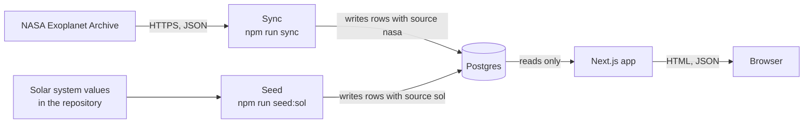

Two rules shape everything else:

1. **Data flows one way.** The sync and the seed write to the database. The app only reads, and in production it connects with a database role that may do nothing else. No request from a browser ever changes data.
2. **The database is the only connection between the two sides.** The sync does not know the app exists, and the app does not call NASA. If NASA is down, the site keeps working with the last synced data. If the sync breaks, the site still works.

| Part | Technology | Runs in production | Runs locally |
| --- | --- | --- | --- |
| Database | Postgres 17 with the `pg_trgm` extension | Neon, Frankfurt | Docker (`docker-compose.yml`) |
| Sync and seed | TypeScript scripts, started with `tsx` | GitHub Actions, daily | `npm run sync`, `npm run seed:sol` |
| App | Next.js 16 (App Router), React 19, Tailwind 4, on Node.js 24 | Vercel Functions in Frankfurt (`fra1`) | `npm run dev` |
| Database access | Drizzle ORM on top of `postgres.js` | inside the scripts and the app | the same |
| Planet images and 3D models | WebGL 2 with our own shaders | in the browser | the same |
| Map | three.js | in the browser | the same |
| Tests | Vitest, Playwright with axe-core | GitHub Actions on every change | `npm run test:all` |

## Where it runs

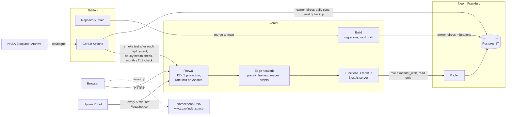

- **Namecheap** holds the domain `exofinder.space` and its DNS, which points at Vercel. Vercel redirects the domain without `www` to `https://www.exofinder.space`.
- **Vercel** serves the site. The firewall in front stops floods and limits search requests per IP. The edge network delivers what does not change between requests: the prebuilt page frames, images, scripts and the legal pages. Everything that needs the database runs in a function in Frankfurt, next to the database.
- **Neon** holds the database in Frankfurt. The site reaches it through Neon's pooler, because Vercel starts many functions at once. The database goes to sleep after a few minutes without queries and wakes on the next one.
- **GitHub** holds the code and runs everything that is not a page view: the checks of every change, the daily sync with NASA, the weekly backup, the smoke test after each deployment, the hourly health check and the monthly TLS check.
- **UptimeRobot** asks the site every five minutes from the outside and e-mails when it does not answer. It asks the prebuilt legal notice, so the database can sleep in between.

### Who may do what

Each part gets only the access it needs.

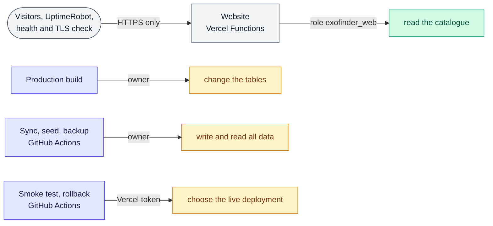

| Who | Connects with | May |
| --- | --- | --- |
| The website (Vercel Functions) | `DATABASE_URL_READONLY`: role `exofinder_web`, through the pooler | read, every query cancelled after 5 seconds |
| The production build | `DATABASE_URL_UNPOOLED`: the owner, direct | change the tables (migrations) |
| Sync, seed and backup (GitHub Actions) | secret `PRODUCTION_DATABASE_URL`: the owner, direct | write and read all data |
| Smoke test and rollback (GitHub Actions) | `VERCEL_TOKEN`, `VERCEL_AUTOMATION_BYPASS_SECRET` | open protected deployments, choose which deployment is live |
| Health check, TLS check (GitHub Actions), UptimeRobot | nothing but HTTPS | read pages, like a visitor |
| Visitors | nothing but HTTPS | read pages |

### The automatic jobs

| Workflow | When | Does |
| --- | --- | --- |
| [ci.yml](../.github/workflows/ci.yml) | every pull request and push to `main` | type check, lint, unit, database and browser tests, `npm audit`, build |
| [codeql.yml](../.github/workflows/codeql.yml) | every pull request and push to `main`, Mondays | scans the code for security problems |
| [deploy-check.yml](../.github/workflows/deploy-check.yml) | after every Vercel deployment | smoke test; puts the previous production deployment back if production fails it |
| [health.yml](../.github/workflows/health.yml) | hourly | asks `/health` on the live site |
| [sync.yml](../.github/workflows/sync.yml) | daily, 03:17 UTC | compares the catalogue with NASA and writes the differences |
| [backup.yml](../.github/workflows/backup.yml) | Sundays, 04:41 UTC | dumps the database and keeps the dump for 90 days |
| [tls.yml](../.github/workflows/tls.yml) | 1st of every month | protocols, certificates, headers and redirects of the live site |
| [Dependabot](../.github/dependabot.yml) | Mondays | pull requests for outdated or vulnerable dependencies |
| UptimeRobot (outside the repository) | every 5 minutes | asks `/legal/notice` on the live site |

A failed run turns red and GitHub sends an e-mail; UptimeRobot sends its own. What each check catches: [TESTING.md](TESTING.md).

### From a change to the live site

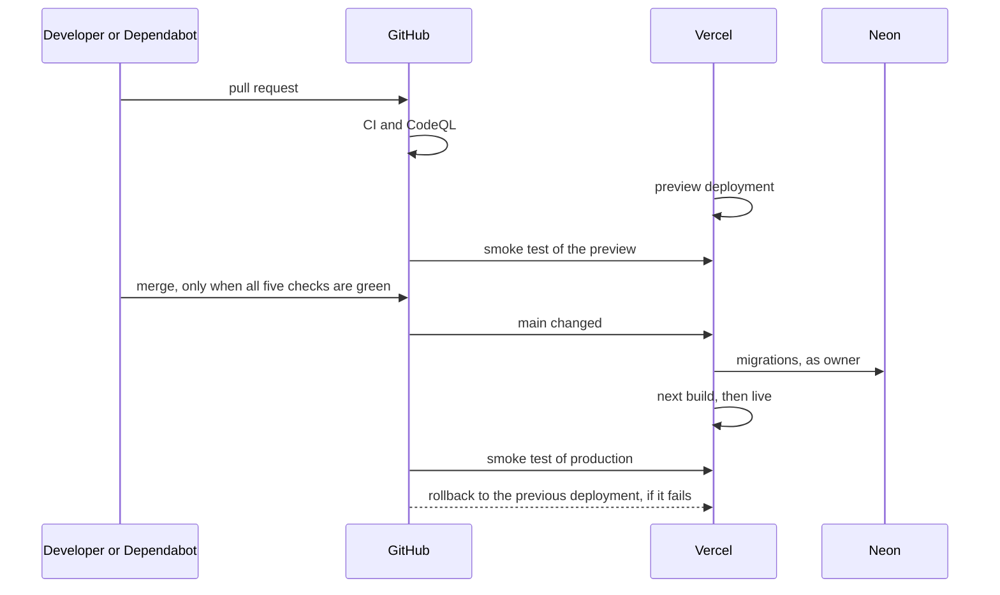

`main` only accepts pull requests whose checks `check`, `audit`, `db`, `e2e` and `analyze` are green, and it cannot be deleted or force-pushed. Setting all of this up, step by step: [DEPLOYMENT.md](DEPLOYMENT.md).

## Code layout

Every feature lives in its own folder inside `src/app/`. A feature folder holds everything that belongs to the feature: its pages, its components, its database queries and its logic. Its tests live in `tests/`, at the same path: the tests of `src/app/planets/classify.ts` are in `tests/unit/app/planets/classify.test.ts`.

```
.github/
  workflows/              CI, CodeQL, deployment check, health check, TLS check, sync, backup
  dependabot.yml          weekly update pull requests
scripts/
  sync.ts                 command line entry: calls runSync
  seed-solar-system.ts    command line entry: calls seedSolarSystem
  migrate-on-deploy.ts    migrations during a Vercel production build
  create-readonly-role.ts creates the read-only database role of the website
  rollback-production.ts  puts the previous production deployment back live
  check-tls.sh            checks protocols, certificates, headers and redirects of the live site
  fetch-textures.ts       downloads and scales the images in public/textures
  moon-maps.ts            turns the published mosaics of the moons into textures: centre, colour, brightness, gaps
  generate-presets.ts     simulates the base maps of the exoplanets and writes presets.json
  preview-presets.ts      writes the three channels of a base map side by side, to look at them
  planet-sheet.ts         draws a spread of planets from the catalogue onto one picture
  docs-screenshots.ts     takes the screenshots of the user guide with headless Playwright
docs/
  ARCHITECTURE.md         this file
  DEPLOYMENT.md           hosting, setup step by step, operations
  wiki/                   the user guide as GitHub Wiki pages, with its screenshots in images/
drizzle/                  SQL migrations: one generated from the schema, two written by hand
public/textures/          surface maps of the solar system and its moons, base maps of the exoplanets, panorama of the sky
tests/
  unit/                   unit tests, at the same paths as the code in src/
  scripts/                tests that run a script of scripts/ from start to end
  db/                     tests against a real PostgreSQL
  e2e/                    browser tests (Playwright): flows, what the shaders draw, security, accessibility
  smoke/                  the smoke test that runs against every deployment
  support/                test catalogue, test databases, sample rows from NASA
vercel.json               build command for Vercel
src/
  proxy.ts                answers broken percent-encoding with 400
  db/
    schema.ts             all tables
    client.ts             the database connection (getDb, closeDb), read-only inside Next.js
    readonly.ts           the statements that create the read-only role
  deploy/
    rollback.ts           picks the deployment to roll back to
  shared/
    slug.ts               names to URL slugs and search keys
    format.ts             numbers, dates and unit conversions
    security-headers.ts   the HTTP headers of every answer
    ui.tsx                small building blocks: Section, Facts, Fact, Notice, PageSkeleton
  app/
    layout.tsx            frame of every page: header, footer
    page.tsx              start page  /
    SiteHeader.tsx        the bar at the top with the search field and the links
    error.tsx             shown when a page fails
    not-found.tsx         shown for unknown addresses
    globals.css           what Tailwind needs to know: colours, fonts, two variants, two utilities
    catalog/              numbers and featured planets on the start page
    search/               /search, /search/suggest and the search field
    planets/              /planets (the list), /planets/[slug], classification, still images
      globe/              the moving image and the 3D model (WebGL)
    stars/                /stars/[slug], sky coordinates
    map/                  /map, /map/stars, /map/systems/[slug], galaxy model, orbits, belts
      scene/              everything that draws the map (three.js)
    sync/                 the comparison with NASA
    solar-system/         the Sun and its eight planets, /solar-system/[slug]: the large moons, Ceres and Pluto
    legal/                /legal/notice, /legal/privacy and who runs this copy
    health/               /health: is the site up and does it reach its database
```

Next.js only turns files named `page.tsx` and `route.ts` into addresses. Every other file in `src/app/` is ordinary code, so features can keep their logic next to their pages.

| File in a feature folder | Role |
| --- | --- |
| `page.tsx`, `route.ts` | An address of the site |
| `queries.ts`, `query.ts`, `stats.ts` | Reads from the database |
| `*.tsx` with a capital letter | A component |
| other `*.ts` | Logic without database or UI, for example `classify.ts` |

`src/` holds only the app. Every test lives in `tests/` ([TESTING.md](TESTING.md)).

### Who may import whom

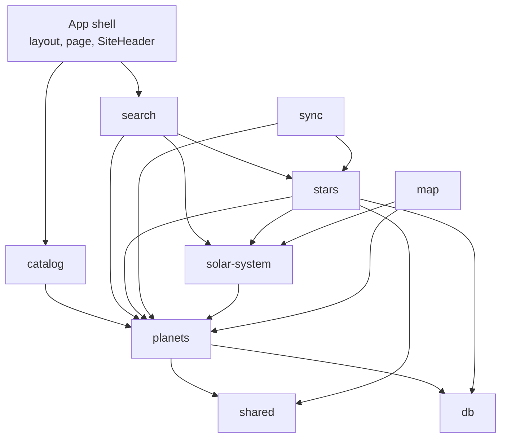

Every feature may use `shared` and `db`; the diagram only draws those arrows for `planets` and `stars`. `planets` is the base feature and imports no other feature, with one exception: the page of a solar-system planet lists its moons, so [planets/[slug]/page.tsx](../src/app/planets/[slug]/page.tsx) imports the list and its card from `solar-system`. Only that page does, so no module imports itself in a circle. `solar-system` builds on `planets` for the look of its bodies; `search`, `stars` and `map` take the moons and dwarf planets from it. Nothing imports `sync` except its script. `map` is imported by nobody; the pages only link to it.

### Styling

All styling is done with Tailwind classes in the components. There is one stylesheet, [globals.css](../src/app/globals.css), and it holds no rules of its own, only what Tailwind needs to know:

| In `globals.css` | What it gives the components |
|---|---|
| `@theme` | The seven colours of the site as classes: `bg-surface`, `text-muted`, `border-line`, `text-accent` and so on. The fonts from `next/font`. |
| `@custom-variant on-start-page` and `on-map-page` | Classes that apply only on one page, for the parts of the layout that differ there. The header hides its search field on the start page (`on-start-page:invisible`), the layout drops the footer and stops scrolling on the map (`on-map-page:hidden`, `on-map-page:h-dvh`). |
| `@utility planet-dot` and `planet-dot-banded` | The plain planet image of the list. Five gradients on top of each other do not fit into a class name. |

The map builds its canvas and its labels in code, not in JSX. They get the same classes through `className` ([map/scene/engine.ts](../src/app/map/scene/engine.ts), [map/scene/labels.ts](../src/app/map/scene/labels.ts)); Tailwind reads class names from every source file.

Two things are still set as a style, because their values are not known when the stylesheet is built:

- **The three colours of a planet in the list.** They come from the data, one set per planet, and are handed over as CSS variables ([PlanetDot.tsx](../src/app/planets/PlanetDot.tsx)).
- **Where a label of the map stands.** Its place, and the size of the ring around the selected object, change with every frame.

The still images are SVG, and the moving images and the map are drawn with WebGL. Their colours and shapes are drawing instructions, not styling, and stay in the code that draws them.

## Database

Six tables, defined in [src/db/schema.ts](../src/db/schema.ts).

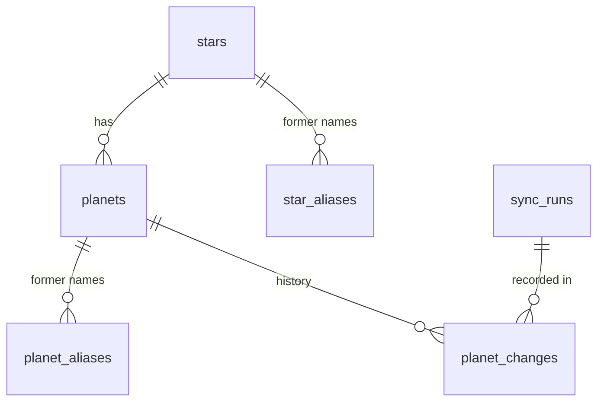

| Table | Content |
| --- | --- |
| `stars` | Stars with at least one known planet, plus the Sun. Holds the position in the sky and the precomputed galactic position `x`, `y`, `z` for the map. |
| `planets` | Planets with their measured values, a flag per value that says whether NASA only calculated it, the planet class, the climate class and a hash of the values. |
| `star_aliases`, `planet_aliases` | Former names, so old addresses lead to the new page after a rename. |
| `sync_runs` | One row per sync run with its counts, including failed runs and their error. |
| `planet_changes` | The history: which value changed from what to what, and in which run. |

Three columns carry the design:

- **`source`** is `nasa` or `sol`. The sync only touches `nasa` rows. The solar system is `sol` and comes from the seed. This is how both live in the same tables without getting in each other's way.
- **`status`** is `active` or `removed`. When NASA drops a planet, the row stays and is marked `removed`, so its page and history survive.
- **`search_name`** is the name reduced to lower-case letters and digits: `Kepler-22 b` becomes `kepler22b`. The search runs on this column. A trigram index (`gin_trgm_ops`) makes "contains" searches fast.

The schema is the single source of truth. `npm run db:generate` turns a schema change into a SQL migration in `drizzle/`, and `npm run db:migrate` applies it.

Two migrations are written by hand, because they set up things a Drizzle schema cannot describe: `0000_extensions.sql` switches on `pg_trgm`, and `0002_natural_order.sql` creates the collation `natural_name`. A collation is a rule for sorting text. This one counts digits as numbers, so `Kepler-9 b` comes before `Kepler-10 b`; the list of all planets sorts with it.

## Data flow 1: from NASA into the database

`npm run sync` starts [scripts/sync.ts](../scripts/sync.ts), which calls `runSync` in [src/app/sync/run.ts](../src/app/sync/run.ts).

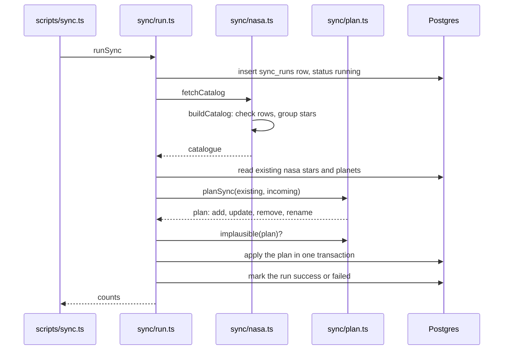

The work is split into three steps on purpose:

1. **Fetch** ([nasa.ts](../src/app/sync/nasa.ts)). One request to the archive's TAP interface for about 30 columns of the table `pscomppars`. `buildCatalog` checks every row and groups the planet rows by star. NASA delivers star values once per planet, and for some stars the rows disagree. The most common value wins.
2. **Plan** ([plan.ts](../src/app/sync/plan.ts)). `planSync` compares the catalogue with what is stored and returns a plan. It does not touch the database, so the whole logic is covered by ordinary tests.
3. **Apply** ([run.ts](../src/app/sync/run.ts)). The plan is written in a single transaction. If anything fails, the database stays exactly as it was.

What the plan takes care of:

- **Changes.** Each planet has a SHA-256 hash over 17 tracked values. If the hash is the same, the planet is skipped. If it differs, every changed value goes into `planet_changes` with its old and new value.
- **Removed planets.** A planet missing from the catalogue is marked `removed`. If it comes back, it becomes `active` again.
- **Renames.** NASA has no stable ids. A star counts as renamed when one name disappears and a new one appears within 5 arcseconds of the same position. A planet counts as renamed when exactly one new planet at the same star has the same orbital period (within 1 %) or the same letter. The old name is kept as an alias.
- **Broken responses.** The run stops when fewer than 1,000 planets arrive, when fewer than 90 % of the stored planets arrive, or when more planets would be removed than the limit of 25 or 5 %. `npm run sync -- --force` overrides this.

The `sync_runs` row is written outside the transaction, so a failed run still leaves a record with its error message.

`npm run seed:sol` is the small sibling: [seed.ts](../src/app/solar-system/seed.ts) writes the Sun and the eight planets from [data.ts](../src/app/solar-system/data.ts) as `sol` rows. It can run any number of times.

The round moons of the planets and the dwarf planets Ceres and Pluto (with Charon) are not in the database. They live in [bodies.ts](../src/app/solar-system/bodies.ts), with their values from JPL Solar System Dynamics, because nothing ever syncs them and they belong to no star's list of planets: the numbers on the start page, the list of all planets and the filters stay about planets. Their pages, `/solar-system/[slug]`, are built ahead of time from that list. Masses are stored as G·M, which spacecraft measure far more precisely than the mass itself, and converted relative to Earth for the page. A test checks that each density agrees with its mass and radius, which caught a value in JPL's table that does not (Charon's; the page uses the one from New Horizons).

### Values derived on the way in

Both the sync and the seed pass every planet through `withDerived` in [planets/measurements.ts](../src/app/planets/measurements.ts). It adds three columns:

| Column | Rule ([classify.ts](../src/app/planets/classify.ts)) |
| --- | --- |
| `planet_class` | From the radius in Earth radii: rocky below 1.25, super-Earth below 2, Neptune-like up to 6, gas giant above. Without a radius it is estimated from the mass (Chen & Kipping 2017). |
| `climate_class` | From the equilibrium temperature: frozen below 150 K, cold below 250 K, temperate below 350 K, hot up to 1,000 K, scorching above. |
| `data_hash` | The hash that the next sync compares against. |

The equilibrium temperature ignores any atmosphere. That is why Venus counts as "cold" here although its surface is the hottest in the solar system. For exoplanets no better value exists, and the same rule is applied to every planet.

For stars, the sync also converts right ascension, declination and distance into galactic coordinates ([stars/coordinates.ts](../src/app/stars/coordinates.ts)). The map reads them directly.

## Data flow 2: from the database to the browser

Pages are server components. They query the database on the server and send finished HTML. The browser gets no database access. Three things run in the browser: the suggestions of the search field, the moving planet images with the 3D model, and the map. Everything else works without JavaScript, and every planet has a still image in the HTML.

### Static frame, streamed content

The app uses Next.js Cache Components (`cacheComponents: true` in [next.config.ts](../next.config.ts)). Every page has two layers:

- The **frame** (header, headings, search field, skeletons) is built once at build time and is served immediately.
- The **content** that depends on the database or on the address sits inside `<Suspense>`. It is computed on every request and streamed into the open response as soon as it is ready.

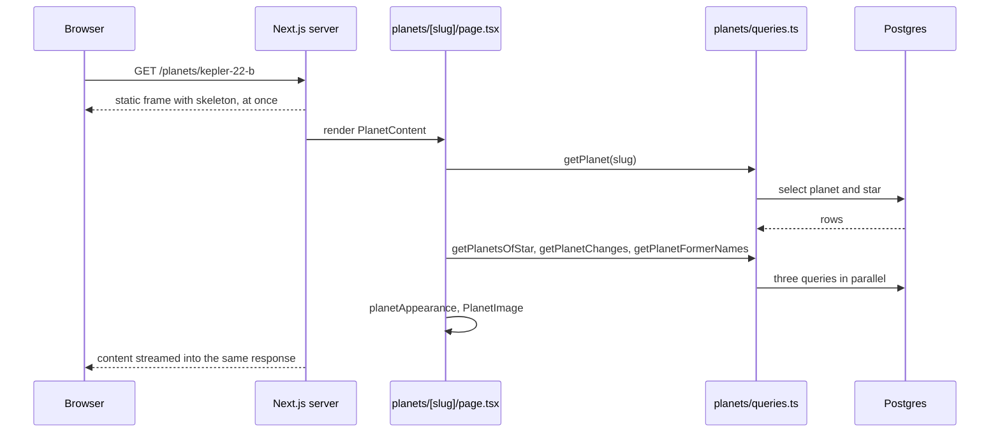

Because the build never needs the database, `npm run build` works without one. Each page reads the current state at request time, so a finished sync shows up on the next page view without a rebuild.

### The pages

| Address | File | Reads |
| --- | --- | --- |
| `/` | [app/page.tsx](../src/app/page.tsx) | Nine featured planets ([FeaturedPlanets.tsx](../src/app/catalog/FeaturedPlanets.tsx)) and the catalogue numbers ([stats.ts](../src/app/catalog/stats.ts)), each in its own `<Suspense>` |
| `/planets?q=&sort=&page=` | [planets/page.tsx](../src/app/planets/page.tsx) | 200 planets of the list of all planets, and how many there are in total |
| `/planets/[slug]` | [planets/[slug]/page.tsx](../src/app/planets/[slug]/page.tsx) | The planet with its star, the other planets of the system, the change history, former names |
| `/stars/[slug]` | [stars/[slug]/page.tsx](../src/app/stars/[slug]/page.tsx) | The star, its planets (removed ones listed separately), former names |
| `/search?q=` | [search/page.tsx](../src/app/search/page.tsx) | Up to 60 matching planets and stars |
| `/search/suggest?q=` | [search/suggest/route.ts](../src/app/search/suggest/route.ts) | Up to 8 suggestions as JSON |
| `/map` | [map/page.tsx](../src/app/map/page.tsx) | Nothing. The page is only a frame; the map fetches its data itself |
| `/map/stars` | [map/stars/route.ts](../src/app/map/stars/route.ts) | Every star with a position, as JSON |
| `/map/systems/[slug]` | [map/systems/[slug]/route.ts](../src/app/map/systems/[slug]/route.ts) | One star with its active planets, as JSON |
| `/legal/notice`, `/legal/privacy` | [legal/notice/page.tsx](../src/app/legal/notice/page.tsx), [legal/privacy/page.tsx](../src/app/legal/privacy/page.tsx) | Nothing. Both are static and take the operator from environment variables |

All database reads go through the query files of the features. They call `getDb()` from [db/client.ts](../src/db/client.ts), which opens the connection pool on first use and reuses it afterwards. `getPlanet` and `getStar` are wrapped in React's `cache`, because the page title and the page body both ask for the same row within one request.

### The legal pages

German law asks a website for a legal notice ("Impressum") that names who runs it, and the GDPR for a privacy policy. Both live in [legal/](../src/app/legal/) and are linked from the footer of every page. The map has no footer, so it carries the two links in the corner with its credits.

- **The operator is not in the code.** The repository is public, and a private address does not belong there. [legal/operator.ts](../src/app/legal/operator.ts) reads name, address and e-mail from environment variables (`LEGAL_NAME` and so on, listed in `.env.example`) when the pages are built. Anyone who runs their own copy enters their own details.
- **A page with missing details says so.** As long as a required variable is not set, both pages show a notice that names the missing variables. An empty legal notice that looks finished would be worse than a visible gap.
- **The privacy policy describes this code.** No cookies, no storage in the browser, no statistics, nothing loaded from other servers: the fonts are downloaded by `next/font` at build time and served from the site itself. What remains is the log of the web server, and the text of a search in the address of its request. A change that adds any of these must change the policy with it. The hosting company and the number of days the log is kept are optional variables, because they depend on where a copy runs.
- **Both pages ask search engines not to list them** (`robots: noindex`), so the address does not turn up in search results.

### From measured values to an image

There are no photographs of exoplanets, so every image is computed.

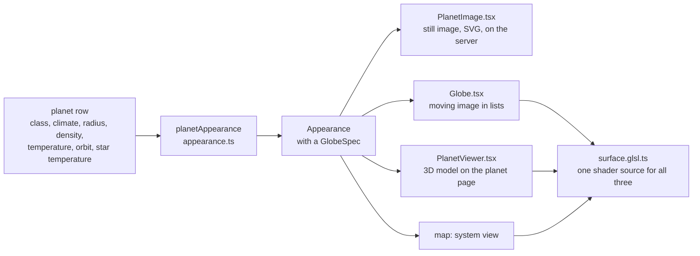

**One description, four pictures.** [appearance.ts](../src/app/planets/appearance.ts) turns what is known about a planet and its star into a description of the planet. Its core is the `GlobeSpec` ([globe/spec.ts](../src/app/planets/globe/spec.ts)): the base maps the planet is drawn from, three surface colours, an ocean with its level, ice, clouds, craters, relief, lava, the belts and winds of a gas planet, an atmosphere, the colour of the starlight, rings, a moon, polar lights, the shape, the tilt of the axis and the spin. The spec is plain data: the server computes it and hands it to the browser as JSON.

**Measured where possible, drawn by lot where not.** Measured values shape the picture wherever they exist:

- **The temperature** gives the colours and the climate. A gas giant takes the colour of the clouds that can exist at its temperature, after Sudarsky's classes: creams and browns of ammonia when cold, white clouds of water, clear blue air, dark when hot, and a glow of its own from about 900 kelvin. The colours run into each other between these, so a planet at 400 kelvin lies between white and blue. On rocky planets the temperature sets the size of the ice caps, the share of clouds, the height of the seas and how much of a molten world is lava.
- **The density**, where both mass and radius were measured (`measuredDensity` in [queries.ts](../src/app/planets/queries.ts)), tells what a rocky planet is made of: a world of iron is darker and greyer, a world of water is nearly all sea, frozen to a shell of ice when cold, under a deck of steam when hot.
- **The orbit** tells whether the planet has days and nights. A planet that circles its star within twelve days is held with one side towards it. It does not turn in front of the viewer (the view swings slowly around it instead), and its climate runs from the point under the star to the night side: ice covers the dark half, lava the bright one.
- **The star** gives the colour of the light, and with it the colour of plants on mild worlds.

What nobody has measured is drawn from the slug of the planet, so it is the same every time and different from planet to planet: which base maps it gets and how they lie on the ball, a small shift of all its colours, the tilt of its axis, and whether it has rings, a moon, polar lights or lightning. Rings and moons only go to planets far enough from their star to keep them. These parts are invention and say so on the page of the planet ("Nobody has seen this planet up close").

**Base maps instead of photographs.** Exoplanets are drawn from fifteen simulated base maps ("presets") in `public/textures/presets`, made by `npm run presets` ([generate-presets.ts](../scripts/generate-presets.ts)). A preset holds no colours, only what shaped a surface. For rocky planets that is the height after erosion, the places where water gathers, and the craters. For gas planets it is the belts, fine streaks and storms: coloured gas is carried along by jets, a few lasting whirls and turbulence that changes while it flows, which folds the belts into festoons instead of winding them into neat spirals. The shader turns a preset into a planet with the values of that planet: sea level, ice, lava, colours and climate zones. A rocky planet mixes two presets in large patches, each turned any way in space, so hardly two planets share a face; a gas planet turns its preset about the axis only, as its belts have to follow the latitudes. What the app has to know about a preset is in [globe/presets.json](../src/app/planets/globe/presets.json), written by the same script: the heights below which each share of a rocky surface lies, so a sea can cover a chosen share of it, and the winds each banded preset was simulated with, which the shader lets blow on so the clouds drift the way they were drawn out. The planets of the solar system name real maps in `public/textures/planets` instead. Browsers may keep the files in `public/textures` for a day ([next.config.ts](../next.config.ts)), so they are not asked for again on every page.

**The still image** ([PlanetImage.tsx](../src/app/planets/PlanetImage.tsx)) is SVG and part of the HTML. It shows at once and stays where WebGL is missing.

**The moving image** ([globe/Globe.tsx](../src/app/planets/globe/Globe.tsx)) fades in on top of the still image as soon as its first picture is drawn. A browser allows only a handful of WebGL canvases per page, and a list shows dozens of planets. So [globe/cards.ts](../src/app/planets/globe/cards.ts) keeps one hidden WebGL canvas for the whole page, draws the planets into it one after the other and copies each result into the plain canvas of its image. Only images on screen are drawn, 30 times per second at most, less often on a slow device. With `prefers-reduced-motion` each planet is drawn once and stands still.

**The 3D model** ([globe/PlanetViewer.tsx](../src/app/planets/globe/PlanetViewer.tsx)) on the planet page has a renderer of its own. Dragging turns the camera around the planet, so the night side comes into view. The wheel (with Ctrl, or in full screen), a pinch or the buttons zoom in up to eight times, and the keyboard works too. Zooming in adds finer detail to the clouds, the coasts and the grain of the ground, computed on the spot, and loads nothing new.

**How a planet is drawn.** [globe/renderer.ts](../src/app/planets/globe/renderer.ts) uses no geometry at all. One triangle covers the picture, and for every pixel the fragment shader ([globe/globe.glsl.ts](../src/app/planets/globe/globe.glsl.ts)) works out which point of the ball lies behind it. That gives a perfectly round edge at any zoom. The surface itself comes from [globe/surface.glsl.ts](../src/app/planets/globe/surface.glsl.ts): the map of the planet turned into ground, seas, lava or bands, layered noise for clouds and fine grain, light and shadow from the star, clouds that shade the ground, city lights and clouds for Earth, rings that cast a shadow on the planet and the planet's shadow on the rings, polar lights and lightning on the night side, storms, and air that veils the day side and glows red where the star stands low. The colours leave the shader the way a camera would record them: bright light is pressed together instead of cut off, and a grain finer than one step of brightness keeps dark slopes from showing stripes. A fast-turning giant is drawn flattened at its poles, and a moon as a small ball of its own. [globe/uniforms.ts](../src/app/planets/globe/uniforms.ts) translates a `GlobeSpec` into the numbers that shader reads. The map includes the same shader code, so a planet looks the same on its page and on its orbit.

**Storms.** They live and die, and only depend on the time and the seed of the planet, so a planet has the same weather whenever it is shown at the same moment. Over the sea of a rocky planet, a few slots take turns at a storm: a tropical cyclone forms near the equator, drifts west, swings towards the pole, grows an eye and spiral arms and dies over land (read from a coarse level of the preset) or after its time; storms of the middle latitudes are wider, have no eye and drift east. Lightning flashes in their thunderclouds on the night side. A dry planet with air, and Mars, gets dust storms that spread and settle, and now and then one wraps the whole planet. On a gas giant the largest storms of its preset turn: [generate-presets.ts](../scripts/generate-presets.ts) writes where they are into `presets.json`, and the shader turns the picture around them, in the same two phases as the drifting bands, so they never wind up. Now and then a bright plume of fresh cloud breaks out and is drawn out along its band, as on Saturn.

**What keeps a picture cheap.** The surface shader runs for every pixel of a planet, sixty times a second, so what it does not have to do counts. Two things, neither of which changes the picture:

- **Storms are worked out once per picture, not per pixel.** Where a storm is, how large and how old is the same for every pixel. [globe/storms.ts](../src/app/planets/globe/storms.ts) works it out for the moment of the picture and hands the shader only the storms that are alive (`stormUniforms`, with the same integer hash the shader uses elsewhere). Inside the shader the graphics card ran the whole of it for every pixel and every slot, also where no storm was: on a planet with a sea that was a third of the time of a picture.
- **Nothing is worked out where it cannot show.** The fine lumps of the clouds are left out where the sky is clear or overcast anyway, the crust of lava outside the seas of lava, dunes outside the lowlands, the billows of dust outside the dust storms, the lumps of an outbreak away from its plume, the waves in the glint of the star where there is no glint.

Measured on a small built-in graphics card (Radeon 610M), a planet that fills 1200 × 1200 pixels: a world with a sea 12.5 ms per picture instead of 16.4, a dry or lava world 11 instead of 11.5, Mars 8.3 instead of 9.5, Earth 6.9 instead of 7.1, a gas giant 3.4 instead of 4.7 (it lost a grain that was multiplied onto its colours and made the bands look painted). Fine detail is never traded for speed: it is what makes the drifting clouds look alive.

**No grain finer than a pixel.** Much of the surface is layered noise, down to grain that repeats 120 times per planet radius. On a planet a few hundred pixels wide those layers are finer than a pixel: each pixel catches them at random, they show as speckles, and they shimmer while the planet turns. So every layer is faded out once its features shrink below two pixels (`shows` and the `scale` of `fbm` in surface.glsl.ts; the size of a pixel on the planet is read off the neighbouring pixels). Zoomed in, the layers come back. Every layer is still read, faded or not: asking first whether to read it costs more on the graphics card than the reads it saves. The light that gives clouds their body is read off the neighbouring pixels too, which the graphics card hands over in blocks of two by two; where a cloud changes too much from one pixel to the next, that light is left out, or the blocks would show. Drawing four times as many pixels would do the same and cost four times as much.

**Why the 3D model appears at once.** WebGL builds a shader when it is first used. On Windows, browsers hand shaders to Direct3D, whose compiler takes several seconds for a large shader with many loops, and our first shader needed almost five. Three things keep that short and out of the way:

- **Noise from a texture.** The shader does not calculate its noise. [globe/noise.ts](../src/app/planets/globe/noise.ts) computes gradient noise once in the browser (about 20 ms) into a 64³ texture, and the shader reads one texel per layer of noise. The pattern repeats every 8 units; the layers are scaled by 2.02 and shifted, so the repetition does not show.
- **One program per kind of surface.** Whether a planet is drawn from a real map, a terrain preset or a band preset, and whether its heights catch the light, is fixed when the shader is compiled (`surfaceDefines` in uniforms.ts, `#if` in surface.glsl.ts). Each of the four combinations is a program of its own and contains only its own code. Compiling one takes 0.1 to 0.3 seconds instead of 4.7.
- **Built in the background, and ahead of time.** The renderer never asks the driver for a result before `KHR_parallel_shader_compile` reports the program as done, and it does not resize its canvas meanwhile: both would wait for the driver and freeze the page. [globe/GlobeWarmup.tsx](../src/app/planets/globe/GlobeWarmup.tsx) in the root layout builds all four programs in a hidden canvas once the first page is idle ([globe/warmup.ts](../src/app/planets/globe/warmup.ts)). The browser keeps built programs while it runs, so the planet pages opened later find theirs ready.

The map's system view uses three.js, which on its own builds a program the first time something is drawn with it and waits for the driver: entering a system froze the map for most of a second. [scene/shaderGate.ts](../src/app/map/scene/shaderGate.ts) builds the programs of a scene in the background first (`compileAsync`) and leaves out of the picture what still waits for its program, a few frames at most; planets that wait for their maps are built meanwhile. It passes the same defines and the same noise texture, so its planets are cheap to build as well. On their orbits the planets are small and use the small maps; the large maps of a planet load when the camera first follows it.

## Data flow 3: search

The search field offers two paths that end in the same function.

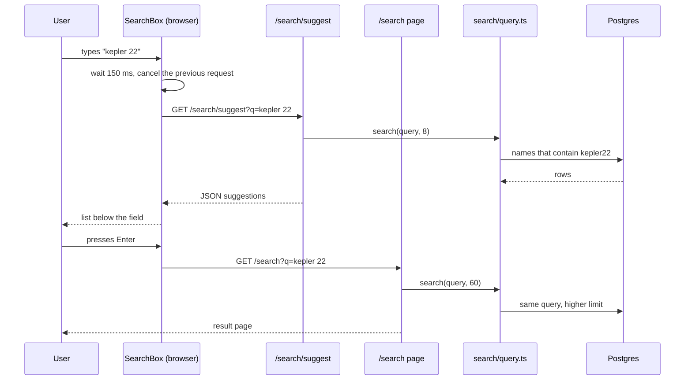

`search` in [query.ts](../src/app/search/query.ts) works in two steps:

1. **Names that contain the query.** The query is reduced to the same form as `search_name`, so `kepler 22b`, `Kepler-22B` and `KEPLER22B` all become `kepler22b`. One SQL statement looks through planets and stars together. Order: the exact name, then names that start with the query as a whole word or number (`Kepler-22 b` for `kepler 22`), then other names that start with it (`Kepler-220`), then the rest. Shorter names come first. The moons and dwarf planets, which live in code, are ranked by the same rules in TypeScript (`matchBodies`) and merged into the rows from the database, so `io` finds Io first. They do not take part in step 2.
2. **Similar names, only if step 1 found nothing.** Trigram similarity from `pg_trgm` catches typos: `proxma` finds Proxima Cen. The result page says that these are only similar names.

Queries shorter than two characters return nothing, and queries are cut off at 80 characters.

The field itself ([SearchBox.tsx](../src/app/search/SearchBox.tsx)) is an ordinary form that leads to `/search`, so it also works when JavaScript has not loaded yet. The suggestions are an addition on top: arrow keys move through them, Enter opens the selected one, Escape closes the list.

### The list of all planets

`/planets` shows every active planet, one per row, 200 per page. A row holds the plain image, the name, the star and the year of discovery. The list is sorted by name or by year of discovery. It is the second way to find a planet, for visitors who want to browse instead of typing a name.

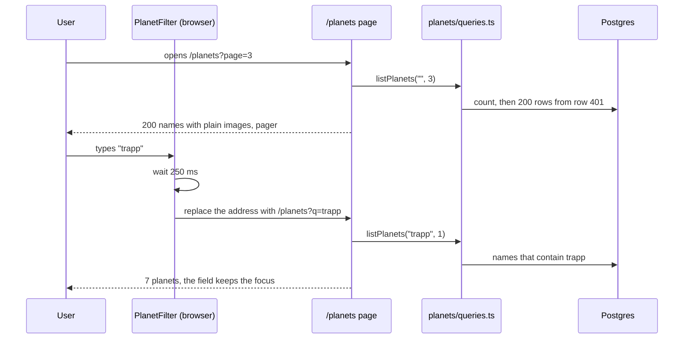

- **The address is the state.** Filter, order and page number live in `?q=`, `?sort=` and `?page=`, nowhere else. A filtered page can be reloaded, shared and reached with the back button. The small rules around that are plain functions in [planets/paging.ts](../src/app/planets/paging.ts): reading the page number (anything odd counts as page 1), reading the order, building an address, choosing which page numbers the pager shows.
- **Two orders.** By name is the default and is left out of the address. `?sort=discovery` sorts by year of discovery with the newest first. The catalogue records the year only, not the day, so planets of the same year follow each other by name. The six planets known since antiquity have no year and come last. The switch above the list is two links; the pager and the filter field carry the chosen order along, and a new order starts on page 1.
- **One page, two database reads.** `listPlanets` in [planets/queries.ts](../src/app/planets/queries.ts) first counts the matching planets, then reads 200 of them with `LIMIT` and `OFFSET`. A page number beyond the end shows the last page. The database sorts all 6,478 planets for each request, which takes about 15 ms in either order; no index is needed at this size.
- **The filter** keeps planets whose name, or the name of their star, contains the text, compared on `search_name` like the search. So `sun` lists the eight planets of the solar system. Unlike the search it does not rank and does not guess at typos: the list keeps its order and only gets shorter.
- **The field** ([PlanetFilter.tsx](../src/app/planets/PlanetFilter.tsx)) is an ordinary form that leads to `/planets`, so Enter works without JavaScript. With JavaScript, typing replaces the address 250 ms after the last key press, and Next.js fetches the new list from the server while the field keeps the focus. The list dims while it waits.
- **The plain image** ([PlanetDot.tsx](../src/app/planets/PlanetDot.tsx)) is one `<span>` with three colours from `planetAppearance`, shaded by CSS gradients (the utility `planet-dot` in [globals.css](../src/app/globals.css)). No SVG filter, no canvas, no script. The detailed, turning image would mean 200 canvases to redraw per page.
- **No prefetching.** The 200 links are marked `prefetch={false}`. Otherwise Next.js would fetch the frame of every planet page that scrolls into view.

## Data flow 4: the map

`/map` is the one page that is an application in the browser. The page itself ([map/page.tsx](../src/app/map/page.tsx)) is a static frame. [MapLoader.tsx](../src/app/map/MapLoader.tsx) loads the map only in the browser, so three.js is not part of any other page.

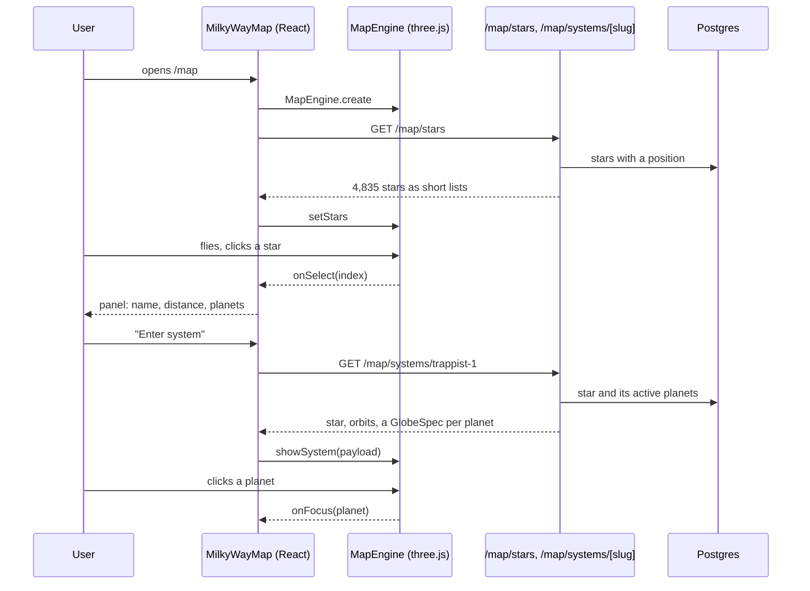

**Two halves with a narrow border.** [MilkyWayMap.tsx](../src/app/map/MilkyWayMap.tsx) is React: it fetches the data, holds what is selected and draws the panels, the star finder and the buttons. [scene/engine.ts](../src/app/map/scene/engine.ts) is plain three.js: it owns the canvas, the drawing loop and mouse, touch and keyboard. React tells the engine what to show (`setStars`, `select`, `flyToStar`, `flyHome`, `flyToOverview`, `showSystem`, `showGalaxy`, `focusPlanet`, `setPaused`), and the engine reports back through three callbacks (`onSelect`, `onFocus`, `onEscape`). Nothing that changes 60 times per second is React state.

**The address is the state.** `/map?star=trappist-1` selects a star, `/map?system=sun&planet=saturn` opens a system and follows a planet, `/map?system=sun&planet=saturn&moon=titan` follows one of its moons, `/map?view=galaxy` shows the whole galaxy. The map writes the current place back into the address, so every view can be shared, and the star and planet pages link straight to their place on the map.

**Two scenes.** From the whole galaxy down to a planet is a factor of a trillion, too much for one scene. So there are two, and the picture fades through black between them:

| | Galaxy ([scene/galaxyView.ts](../src/app/map/scene/galaxyView.ts)) | System ([scene/systemView.ts](../src/app/map/scene/systemView.ts)) |
| --- | --- | --- |
| Unit | Parsec, the Sun at the origin, as stored in `stars.x`, `y`, `z` | Free units, the star at the origin |
| Shows | The sky, the stars with planets, the model of the galaxy | The star, its planets on their orbits |
| Camera | Free flight: drag to look, W A S D to fly, wheel to move forwards. Or circling the galactic centre (**Orbit centre**, and after **Whole galaxy**): drag to turn round it, wheel or W and S to zoom | Circles the star or the planet it follows |
| Data | `/map/stars`, once | `/map/systems/[slug]`, on entering |

**What the galaxy view draws**, from back to front:

1. **The sky** ([scene/sky.ts](../src/app/map/scene/sky.ts)): a photograph of the whole Milky Way as seen from Earth, turned so that its band lies in the galactic plane. It fades out within a few hundred parsecs of the Sun, because from elsewhere the sky would look different; leaving the thin disc upwards or downwards counts four times as much as moving along it. From outside the galaxy the background is black.
2. **The galaxy** ([galaxy.ts](../src/app/map/galaxy.ts), `GALAXY_GLOW_FRAGMENT` in [scene/shaders.ts](../src/app/map/scene/shaders.ts)): nobody has a photograph of the Milky Way from outside, so the map uses the artist's impression that Robert Hurt drew for NASA from the surveys of its stars and gas. The picture is the plan of the disc from straight above, laid out to scale with the galactic centre in the middle and the Sun where the artist put it. A flat picture would be wrong from every other side, so the shader gives it a body: most of its light lies in a thin sheet in the plane and is read from the picture as sharp as it is (until the clouds below take its place); the rest is a soft glow of old stars, thickest in the bulge, added up along each line of sight through a sheet of dust (dust is where the picture is darker than its surroundings). From above the galaxy looks like the picture, from the side like a disc with a bulge and a dark lane, and from inside like the band of the Milky Way. The picture is read once when the map opens, shrunk to 512 pixels square while it is decoded ([scene/picture.ts](../src/app/map/scene/picture.ts)), for the plan of the stars, the clouds and the glow; the galaxy fades in as the sky fades out. The glow never reads it sharper than that: once the clouds are there they carry the sharp picture, and the glow reads its soft light from a blurred level of the picture (the levels are counted for a picture 4096 pixels wide, so any size gives the same blur). So the file is only 1024 pixels square and 80 KB. Seen from outside, a picture would still look like a picture, so from there it is only the plan and is not drawn itself ([galaxyClouds.ts](../src/app/map/galaxyClouds.ts)): where it is bright, and more so where it is brighter than its wider surroundings (in the arms), some 45,000 soft clouds of light are placed in its colours, together with 16,000 clusters of stars drawn as points among the stars; where it is darker than its surroundings, 16,000 clouds of dust. The arms, their gas, young stars and dust lie in a thin layer, as in nature. The height of the galaxy is carried by what has no arms: the smooth thick disc of old stars, which the glow draws from a strongly blurred reading of the picture, an oval bulge (a swarm of yellowish clouds, and in the shader light read from the picture at the same distance from the centre in the oval), and a faint halo. The real disc is about a hundred times as wide as it is thick, which on a screen reads as a sheet of paper, so these heights are drawn larger than they are (the thin layer by `THIN` in galaxyClouds.ts, the thick disc and the bulge in their own sizes), as pictures of galaxies usually do. Seen along the plane, the dust hides most of the thin layer: edge-on the galaxy is a glowing body with a dark lane through its middle. When the camera moves the clouds move against each other, which gives the galaxy depth. Placing them takes a few hundred milliseconds, so a worker does it beside the map ([scene/galaxyClouds.worker.ts](../src/app/map/scene/galaxyClouds.worker.ts)) instead of letting the map stand still. They are drawn into the same picture as the glow, so they cost nothing while the camera rests, and they fade out inside the disc, where the stars take over. A camera that circles the centre rests exactly when it is left alone, so that picture is kept then too.
3. **The stars between them** ([starfield.ts](../src/app/map/starfield.ts), [scene/starfieldView.ts](../src/app/map/scene/starfieldView.ts)): the Milky Way has some hundred billion stars, far too many to store or draw, and from any one place only a few hundred thousand are bright enough to make out. So space is cut into cubes, and a cube only makes its stars when the camera comes near enough to see them, always the same ones, from its own coordinates. Five classes of stars, from red dwarfs to supergiants, each with its own size of cube and its own reach: red dwarfs are made out to 20 parsecs, stars like the Sun to 80, supergiants to 4,000. How many stars a cube holds follows the plan of the arms (the brightness of the artist's impression), a disc that thins out above and below its plane, and the bulge. Where the galaxy is crowded the reach shrinks, so each class keeps to about 50,000 stars. A few cubes are made per frame (3 milliseconds at most), and a class is put on the graphics card at once when all its cubes are there. Near the Sun the bright classes stay hidden while the photograph of the sky shows them anyway, and the faint ones stay dim, so they do not lie over it like grain. Dust in the plane dims what lies far away in it.
4. **Landmarks** ([landmarks.ts](../src/app/map/landmarks.ts)): some twenty famous sights at their published positions: clouds of glowing gas, the shells of dying and exploded stars, young and globular clusters, and the Large and Small Magellanic Clouds outside the Milky Way. Gas is drawn as a picture turned towards the camera, clusters and the two small galaxies also with stars of their own. They get a name when the camera comes near.
5. **The stars with planets**: one point per star at its measured position, coloured by temperature (`starColor`). Near the camera they get names ([scene/labels.ts](../src/app/map/scene/labels.ts), ordinary HTML on top of the canvas).

Adding up the light along every line of sight costs time for each pixel. The galaxy is therefore drawn into a picture of its own with at most 1.3 million pixels, which is stretched over the screen, and that picture is only drawn again when the camera has moved.

**What keeps the map from standing still while it loads.** The shaders are built in the background (`ShaderGate`, see the system view below); the photograph of the sky and the maps of the planets are decoded beside the page as ImageBitmaps (`loadTexture` in scene/picture.ts) instead of on the main thread during the upload; the clouds of the galaxy are placed by a worker. Measured on a small built-in graphics card while the map opens: the whole galaxy blocked the page for 0.66 seconds and now for none, a star system for 0.84 seconds and now for less than a tenth; the whole galaxy loads 1.9 instead of 3.1 MB.

**What the system view draws.** [orbits.ts](../src/app/map/orbits.ts) lays out the orbits (`layoutOrbits`). Real proportions cannot be shown: Neptune is 80 times as far from the Sun as Mercury, and next to their orbits all planets are dust. The layout keeps the order, the eccentricity and the relative speed, squeezes the distances and enlarges the planets. A missing distance is derived from the period with Kepler's third law and the other way round. Positions on the ellipse come from Kepler's equation (`solveKepler`), so a planet is faster close to its star. Every planet is a ball with the shader of its planet page, lit from the position of the star. While the camera follows a planet it turns with it around the star, so the day side stays in view, and time slows down for planets that would otherwise race.

In the solar system Ceres and Pluto have orbits of their own among the planets. The moons appear when the camera follows their planet, and only then are they created and their small maps loaded; a followed moon loads its large map. `layoutMoons` squeezes their distances like the planets' (Callisto, 27 Jupiter radii out, stays within six), keeps their order and their periods relative to each other, and starts them outside the rings. Each orbit lies in the plane of the planet's equator, tilted by the moon's inclination, so the moons of Uranus circle on their side and Triton runs backwards; the Moon's orbit is measured against the ecliptic. The moons are tidally locked: longitude 0 of each map faces the planet. They run on a clock of their own, so they do not crawl while time slows down for the planet.

The asteroid belt, Jupiter's trojans and the Hildas, the Kuiper belt with the scattered disc and the Oort cloud are some 14,500 points ([belts.ts](../src/app/map/belts.ts)), each with an orbit drawn from the distributions the surveys found: the Kirkwood gaps that Jupiter clears, the trojans 60 degrees ahead of Jupiter and behind it, the Hildas in their triangle, the plutinos with Pluto, the cold classical belt close to the ecliptic. The Oort cloud has never been seen; its points stand still at the distances models give, from 2,000 to 100,000 AU. One instanced draw call shows them all, each body a quad of a few pixels, and the vertex shader moves it along its Kepler orbit (`BELT_VERTEX` in scene/shaders.ts), so the processor does no work for them per frame; what never changes, the two vectors that span each orbit, is computed once beforehand (`orbitAxes` in scene/beltsView.ts). They are quads rather than points because ANGLE, which runs WebGL on Direct3D under Windows, draws points through a geometry shader: as points the belts cost 0.7 ms per frame on a small built-in graphics card, as quads too little to tell from the measuring noise while following a planet, and about 0.3 ms in the view of the whole system. Their distances are squeezed by the same rule as the orbits (`viewRadius`), which the shader repeats from the laid-out orbits.

**The answers are short.** `/map/stars` sends each star as a list of seven values (slug, name, x, y, z, temperature, number of planets) instead of an object with named fields, and browsers may keep it for an hour ([payload.ts](../src/app/map/payload.ts)). `/map/systems/[slug]` already contains the `GlobeSpec` of each planet, computed on the server by the same `planetAppearance` as on the planet page, and for the Sun the dwarf planets and the moons with theirs.

## When things go wrong

| Situation | What happens |
| --- | --- |
| The database is down | The start page shows a notice instead of the numbers. Planet, star and search pages show [error.tsx](../src/app/error.tsx) with a "Try again" button. `/search/suggest` answers with status 503 and an empty list, and the field simply shows no suggestions. |
| Unknown planet or star | The page shows the not-found message. |
| Is the site healthy? | `GET /health` answers 200 when the database answers within three seconds, otherwise 503, never cached and without details ([health/route.ts](../src/app/health/route.ts)). The smoke test after each deployment and the hourly health check ask it. |
| An address that cannot be a slug, or is encoded wrongly | A null byte, a slash or an overlong slug is "not found" without a database query. Broken percent-encoding (`/planets/%E0%A4%A`) gets status 400 from [proxy.ts](../src/proxy.ts). |
| The list is asked for a page that does not exist | `/planets?page=999` shows the last page, `?page=abc` the first. A filter that matches nothing gives a hint instead of a list. |
| A planet or star was renamed | The old address leads to the new page. The new page lists the former names. |
| NASA is down or answers nonsense | The sync stops, writes nothing and records the failed run in `sync_runs`. The site keeps showing the last good state. |
| The browser has no WebGL 2 | Planet images stay still (the SVG from the server). The map shows a notice that points to the search and links to the solar system. |
| The map cannot load the stars or a system | `/map/stars` and `/map/systems/[slug]` answer with status 503. The map shows a notice; the sky and the galaxy are still drawn. An unknown star gets status 404. |
| The visitor prefers reduced motion | Planet images stand still, the orbits on the map start paused, and flights and fades on the map happen at once. |

Two limits come from streaming. The server has already sent the status 200 and the page frame before it knows whether the planet exists. So an unknown planet shows the not-found message with status 200 instead of 404, and a renamed planet is redirected by the page itself (a `<meta http-equiv="refresh">` tag) instead of status 308. Visitors see no difference. Search engines handle both less well than real status codes. Addresses outside `/planets/…` and `/stars/…` return a real 404.

## Tests and checks

[TESTING.md](TESTING.md) describes every layer in detail: what runs when, what each layer catches, the test data, and what is not tested automatically. In short:

| Command | Checks |
| --- | --- |
| `npm test` | Unit tests for the logic without database: classification, appearance, coordinates, slugs, formatting, the pages of the planet list, the details of the operator, reading the NASA response, planning the sync, the description of a globe and its shader values, the noise of the planet shaders, the scale of the galaxy, the orbits, the answers of the map, and that the base maps fit their numbers. Also the security headers, the proxy, and what the JSON endpoints answer when the database fails (no details may leak) |
| `npm run test:scripts` | Runs the generator of the base maps at a small size: every preset is simulated, the files come out complete, the same run gives the same files |
| `npm run test:db` | Tests against a real PostgreSQL (`*.db.test.ts`): the search and its ranking, the planet list with filter, order and pages, planets, stars, the map, the figures of the start page, the three JSON endpoints, and whole sync runs (unchanged, changed values, new planets, renames, an implausible or broken answer from NASA). Every query also gets hostile input: SQL fragments, wildcards, null bytes, 100,000 characters |
| `npm run test:e2e` | Browser tests with Playwright ([tests/e2e/](../tests/e2e)): builds the app and clicks through it in Chromium, on a desktop and a phone screen. Start page, header and footer, search with suggestions and keyboard, planet list, planet and star pages with the 3D model, the map, not-found pages, former names. What the shaders draw: planets and the galaxy are drawn in the test browser and their pixels checked, for properties (day and night, moving clouds, aurora and lightning on the night side only) and against small kept pictures. Security: the headers on every kind of answer, hostile input over HTTP, script injection through the address, framing by another site, no CSP violation. Accessibility: axe-core checks every page against WCAG 2.1 A and AA |
| `npm run test:all` | All four |
| `npm run test:coverage` | The unit tests, with a report of the lines of `src/` they reach |
| `npm run test:smoke` | The smoke test ([tests/smoke/](../tests/smoke)) against a running deployment: `/health`, the main pages with their security headers, the JSON endpoints, a short walk in the browser. Runs after every Vercel deployment and rolls production back when it fails ([DEPLOYMENT.md](DEPLOYMENT.md)); `test:e2e` runs it against the local build |
| `npm run typecheck` | Route types and TypeScript |
| `npm run lint` | ESLint |
| `npm run build` | The production build |

The database and browser tests use their own databases (`exofinder_test`, `exofinder_e2e`) and never the one of `DATABASE_URL`. GitHub Actions runs all of it on every pull request and push, with CodeQL and `npm audit` next to it; the live site is watched by the smoke test after each deployment, the hourly health check, the monthly TLS check and an uptime monitor.

## Security

[SECURITY.md](SECURITY.md) describes the measures layer by layer: accounts, code and dependencies, network and transport, the application, the database, privacy, watching and recovery, what to do when something happens, and the known limits. The parts that shape the code:

- **Security headers** on every answer ([security-headers.ts](../src/shared/security-headers.ts)): a Content Security Policy that only allows the site itself and forbids framing, HSTS, and the usual protective headers. Scripts need `'unsafe-inline'` for the inline data of Next.js.
- **Checked input.** Queries use bound parameters. Slugs are checked with `isSlug` ([slug.ts](../src/shared/slug.ts)) before they reach the database, the search reduces a query to letters and digits, and [proxy.ts](../src/proxy.ts) answers broken percent-encoding with 400.
- **Read-only database access.** Inside the Next.js server [client.ts](../src/db/client.ts) connects with `DATABASE_URL_READONLY` when that is set: the role `exofinder_web` ([readonly.ts](../src/db/readonly.ts)) may only `SELECT`, runs every transaction read-only and cancels a query after 5 seconds. Scripts and tests run outside Next.js and write with `DATABASE_URL`.

## Not built yet

- **Real stars without planets.** The stars between the stars with planets are computed (see the map); none of them is a real star of a catalogue.
