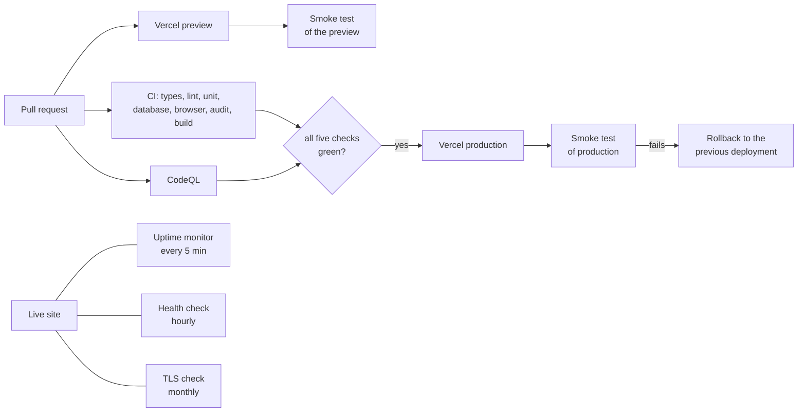

# Tests and checks

What checks ExoAtlas, when it runs and what it catches. The checks form layers: the fast ones run on every change before it can be merged, the slower ones after each deployment, and a few keep watching the live site.

## At a glance

| Layer | Tool | Runs | Catches |
| --- | --- | --- | --- |
| Type check | TypeScript, `next typegen` | every pull request and push to `main` | wrong types, broken route parameters |
| Lint | ESLint with the Next.js rules | every pull request and push | mistakes and patterns the rules forbid |
| Unit tests | Vitest, about 170 tests in 21 files | every pull request and push | errors in the logic, without database or browser |
| Database tests | Vitest against a real PostgreSQL 17 | every pull request and push | wrong queries, ranking, sync runs, hostile input |
| Browser tests | Playwright in Chromium, desktop and phone | every pull request and push | broken pages and flows, security, accessibility |
| Build | `next build` | every pull request and push | anything that only fails when the production build runs |
| Dependency audit | `npm audit` | every pull request and push | known vulnerabilities in dependencies |
| Code scanning | CodeQL, `security-and-quality` | every pull request and push, Mondays | security problems in our own code |
| Smoke test | Playwright against the deployment | after every Vercel deployment | a deployment that does not work; production is rolled back |
| Health check | GitHub Actions, `GET /health` | hourly | the site or its database is down |
| Uptime monitor | UptimeRobot, `/legal/notice` | every 5 minutes | the site does not answer |
| TLS check | `scripts/check-tls.sh` | 1st of every month | weak protocols, an expiring certificate, missing headers, wrong redirects |
| Sync guard | the plan of the sync | daily, with the sync | an implausible answer from NASA; nothing is written |
| Backup | `pg_dump` | Sundays | a dump that would be empty fails the run |

`main` only accepts a pull request when `check`, `audit`, `db`, `e2e` and `analyze` are green. Every scheduled check that fails turns its run red, and GitHub sends an e-mail; UptimeRobot sends its own.

## When what runs

## The layers in detail

### Unit tests

`npm test` ([vitest.config.mts](../vitest.config.mts), project `unit`) runs every `*.test.ts` next to the code it tests. They need neither a database nor a browser and take about a second.

They cover the logic: classification, appearance, coordinates, slugs, formatting, the pages of the planet list, the details of the operator, reading the NASA response, planning the sync, the description of a globe and its shader values, the noise of the planet shaders, the model of the galaxy, the orbits, the answers of the map. And the parts that matter for security and operations: the security headers, the proxy, what the JSON endpoints answer when the database fails (no details may leak), the health report, which address the database connection uses, the statements of the read-only role and the choice of the deployment to roll back to.

### Database tests

`npm run test:db` (project `db`) runs every `*.db.test.ts` against a real PostgreSQL: the search and its ranking, the planet list with filter, order and pages, planets, stars, the map, the figures of the start page, the three JSON endpoints, and whole sync runs (unchanged, changed values, new planets, renames, an implausible or broken answer from NASA).

Every query also gets hostile input: SQL fragments, wildcards, null bytes and 100,000 characters.

### Browser tests

`npm run test:e2e` ([playwright.config.ts](../playwright.config.ts), [e2e/](../e2e)) builds the app, starts it against its own database and clicks through it in Chromium, once on a desktop screen and once on a phone screen (Pixel 7).

| File | Checks |
| --- | --- |
| `navigation.spec.ts` | start page, header and footer, links to the legal pages, not-found pages, old addresses of renamed planets and stars |
| `search.spec.ts` | suggestions while typing, keyboard and Escape, the results page, similar names for typos, empty and unmatched queries |
| `planets.spec.ts` | the list of all planets with filter and order, planet and star pages, the 3D model and its buttons, withdrawn planets, the solar system |
| `map.spec.ts` | loading the stars, finding one by name, opening a system from the address and going back to the galaxy |
| `security.spec.ts` | the headers on every kind of answer, hostile input over HTTP, script injection through the address and the search, `GET` only on the JSON endpoints, framing by another site, broken encoding, null bytes, no violation of the Content Security Policy |
| `accessibility.spec.ts` | axe-core checks every page and the open suggestion list against WCAG 2.1 A and AA; the site can be used with the keyboard alone |

The browser tests fail on every error in the browser console, so a hydration error or a blocked script shows up even when the page looks right. They also run the smoke test against the local build, so a change that would break it shows up before it is merged.

### Smoke test

`npm run test:smoke` ([smoke/](../smoke)) checks a running deployment in about a minute: `/health` answers and runs the expected commit, the main pages answer 200 with their security headers, the JSON endpoints return data, and a short walk in the browser has no console errors. It relies only on the solar system, which every filled database has.

[deploy-check.yml](../.github/workflows/deploy-check.yml) runs it after every Vercel deployment, previews and production. When production fails it, the workflow puts the previous deployment back live ([DEPLOYMENT.md](DEPLOYMENT.md), "Automatic rollback").

### Checks of the live site

- **Health check** ([health.yml](../.github/workflows/health.yml), hourly): `GET /health` must answer 200, which means the site reaches its database. Three tries a minute apart.
- **Uptime monitor** (UptimeRobot, every 5 minutes, set up outside the repository): asks `https://www.exoatlas.space/legal/notice` and e-mails when it does not answer and when it is back. It asks the legal notice, a prebuilt page, so the Neon database can go to sleep between visits; the hourly health check covers the database.
- **TLS check** ([tls.yml](../.github/workflows/tls.yml), monthly, and on pull requests that change it): [check-tls.sh](../scripts/check-tls.sh) checks the security headers, that every way in ends on `https://www.exoatlas.space/`, that TLS 1.2 and 1.3 are accepted and TLS 1.0 and 1.1 refused, and that both certificates are trusted and valid for at least 21 more days. Details: [DEPLOYMENT.md](DEPLOYMENT.md), "TLS check".

### Supply chain

- **`npm audit`** in CI: what ships to visitors must have no known vulnerability at all (`--omit=dev --audit-level=low`); tools that only run during development may have moderate ones, never high or critical.
- **CodeQL** ([codeql.yml](../.github/workflows/codeql.yml)) scans JavaScript and TypeScript with the `security-and-quality` queries. Findings appear under *Security → Code scanning*; one rated high or above fails the check.
- **Dependabot** ([dependabot.yml](../.github/dependabot.yml)) opens pull requests every Monday for npm packages, GitHub Actions and the Docker image of the local database, and at once for a known vulnerability. They go through the same checks as every other change.

## Test data

The database and browser tests never touch the database of `DATABASE_URL`. They create their own, `exoatlas_test` and `exoatlas_e2e`, empty them and fill them with a small test catalogue ([src/test/catalog.ts](../src/test/catalog.ts)): TRAPPIST-1, Proxima Cen b, a few Kepler planets, the solar system, a star without a distance and a planet that NASA withdraws. [src/test/db.ts](../src/test/db.ts) refuses any database whose name does not end in `_test` or `_e2e`. `TEST_DATABASE_URL` and `E2E_DATABASE_URL` point them elsewhere.

## Running them locally

The database and browser tests need the database from `docker-compose.yml` (`npm run db:up`); the browser tests need Chromium once (`npm run e2e:install`).

| Command | Runs |
| --- | --- |
| `npm test` | unit tests |
| `npm run test:db` | database tests |
| `npm run test:e2e` | browser tests, including the smoke test against the local build |
| `npm run test:all` | all three |
| `SMOKE_BASE_URL=https://… npm run test:smoke` | the smoke test against any deployment |
| `bash scripts/check-tls.sh www.exoatlas.space` | the TLS check (needs curl and OpenSSL 3) |
| `npm run typecheck`, `npm run lint`, `npm run build` | type check, lint, production build |

Do not hammer the live site while testing: a few hundred requests from one address in a short time make Vercel's DDoS protection challenge that address for a while ([DEPLOYMENT.md](DEPLOYMENT.md), "TLS check").

## What is not tested automatically

- **How the planets and the map look.** Shaders and the map are checked by eye in a browser. `npm run docs:screenshots` renews the pictures of the user guide; looking over them after a visible change is the closest thing to a visual test.
- **The settings outside the repository**: the firewall rule, the variables in Vercel, the DNS records. The TLS check and the smoke test notice the most important consequences.
- **The wording of the legal pages.** The tests check that they exist and are linked, not what they say.
- **A restore of the backup.** It was tried once in November 2026 and worked; repeat it now and then ([DEPLOYMENT.md](DEPLOYMENT.md), "Backups").

## For new code

- Logic without database or browser gets unit tests next to it.
- A new query gets a database test, including hostile input.
- A new page or flow gets a browser test; a new page also joins the list of `accessibility.spec.ts` and of the security header checks.
- A new address that the smoke test should cover joins [smoke/deployment.spec.ts](../smoke/deployment.spec.ts).
