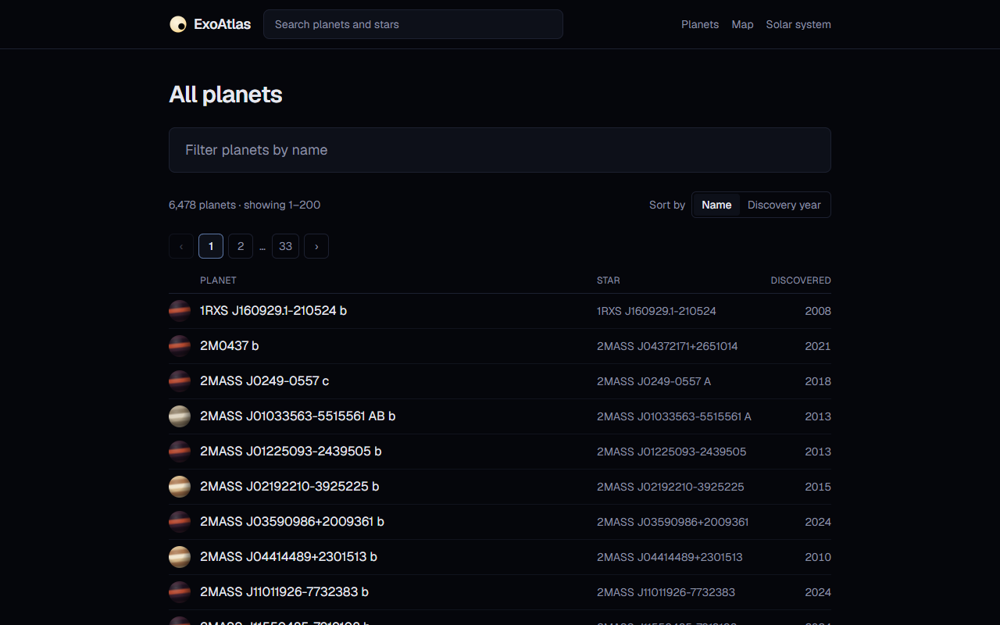
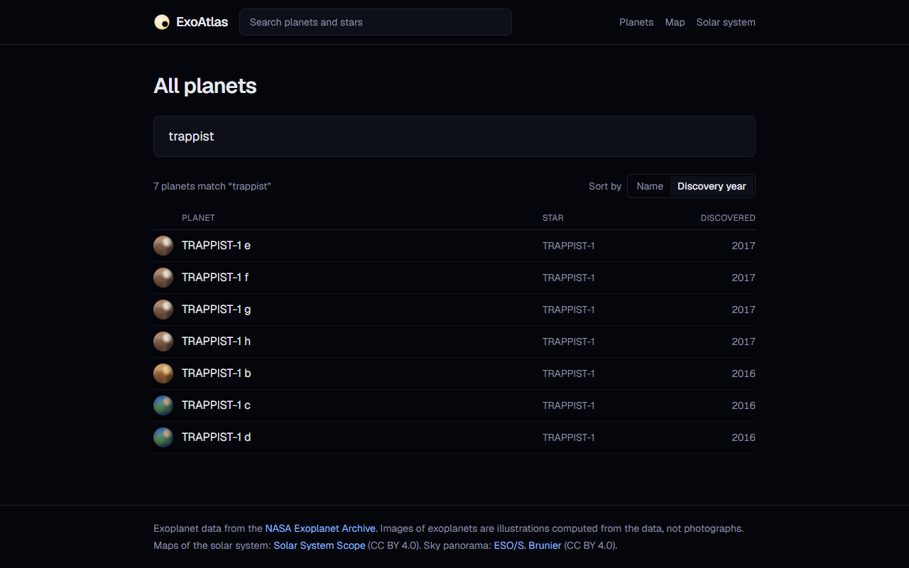

# All planets

The list shows every planet in ExoAtlas: all known exoplanets and the eight planets of our solar system.

## Open the list

1. Click **Planets** in the bar at the top.
2. The page **All planets** opens. Each row is one planet with a small picture, its name, its star and the year it was discovered.
3. Click a row to open the page of that planet.

The list shows 200 planets at a time. Use the page numbers above and below the list to see the next ones. The arrows **‹** and **›** go one page back or forward.

## Show only some planets

1. Click into the field **Filter planets by name** above the list.
2. Type a part of a name, for example `trappist`.
3. The list updates while you type. Above the list you see how many planets match.
4. To see all planets again, empty the field.

## Change the order

The list is sorted by name at first. Next to **Sort by** you can switch:

- **Name** sorts from A to Z.
- **Discovery year** shows the newest discoveries first.

The filter stays when you change the order.

## Good to know

- The planets of our solar system have a dash (–) instead of a year. They have been known since ancient times.
- You can copy the address from your browser and send it to someone. It keeps the filter, the order and the page, so they see the same list.

## Next step

Open a planet and see what its page tells you: [Planet pages](Planet-Pages).
