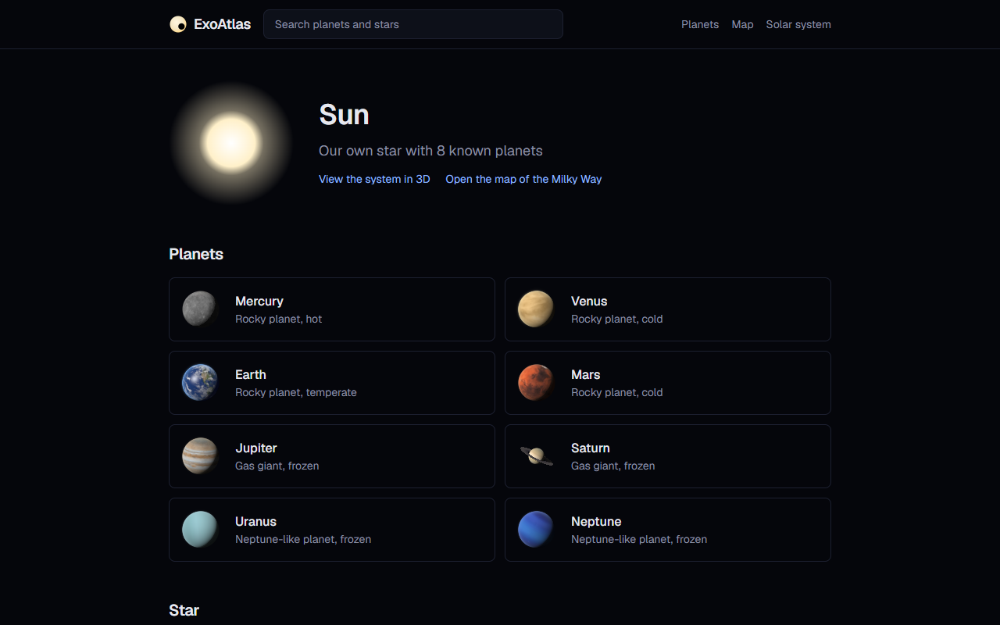
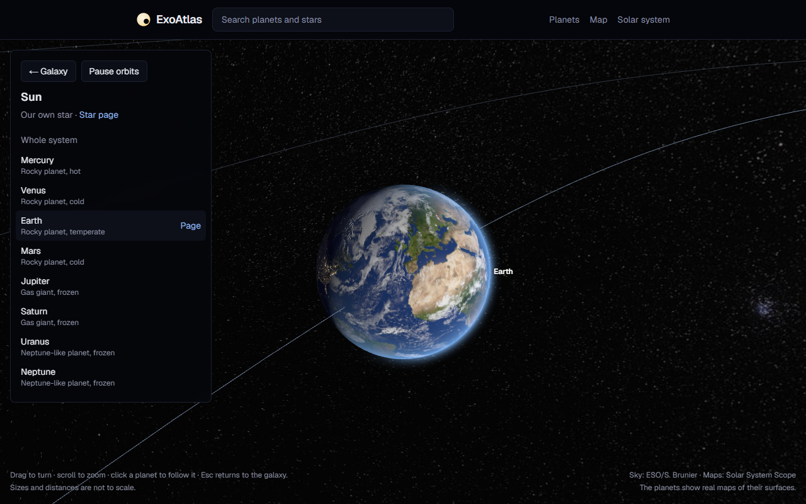

# Our solar system

ExoAtlas also has our own Sun and its eight planets, from Mercury to Neptune. They help you compare: is this exoplanet bigger than Earth? Hotter than Venus?

## Open the solar system

1. Click **Solar system** in the bar at the top.
2. The page of the **Sun** opens. It looks like every other [star page](Star-Pages).
3. Under **Planets** you see the eight planets. Click one to open its page.

## See it in 3D

1. On the page of the Sun, click **View the system in 3D**.
2. The [map](The-Map) opens with the Sun and its planets on their orbits.
3. In the list on the left, click a planet, for example **Earth**. The camera flies to it and follows it.
4. Click **Page** next to the planet to open its page.
5. Click **Whole system** to see all planets again.

## What is different about these planets

- **Real pictures:** the 3D models of the solar system planets use real maps of their surfaces, made from spacecraft images. The exoplanets are computed pictures.
- **Values from another source:** the values come from the NASA Planetary Fact Sheet, not from the Exoplanet Archive.
- **No discovery year:** these planets have been known since ancient times, so the list shows a dash instead of a year.
- **Size comparison:** every planet page compares the planet with Earth, so you can use the eight planets as a reference.
