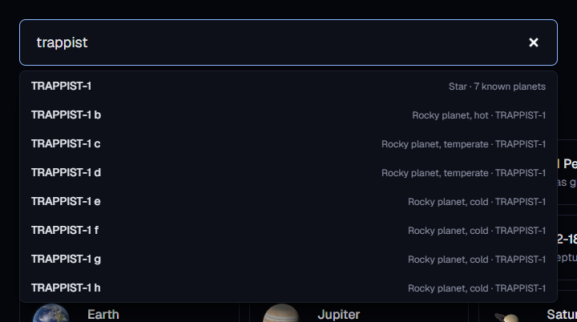
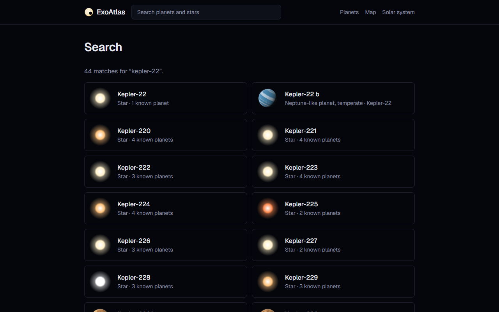

# Searching

The search finds planets and stars by their name. It is in the bar at the top of every page, and in the middle of the start page.

## Find a planet or a star quickly

1. Click into the search field. It says **Search planets and stars**.
2. Type at least two letters of the name, for example `trappist`.
3. A list of suggestions opens below the field. Each line shows the name and, on the right, what it is: a star with its number of planets, or a planet with its kind and its star.
4. Click a suggestion. Its page opens.

**With the keyboard:** press the arrow keys **↓** and **↑** to move through the suggestions, then **Enter** to open the marked one. **Esc** closes the list.

## See all results

Sometimes you want to see everything that matches, not just the first suggestions.

1. Type the name or a part of it.
2. Press **Enter** without choosing a suggestion.
3. The search page opens with all planets and stars that match, up to 60 of them. Planets show their star next to their name.
4. Click a card to open its page.

## Tips

- **Upper and lower case do not matter.** `kepler-22`, `Kepler-22` and `KEPLER-22` find the same.
- **A part of the name is enough.** `22 b` finds Kepler-22 b.
- **Typos are forgiven.** If no name contains what you typed, the search shows names that are similar.
- **Too many results?** Type more of the name. The page tells you when there are more matches than it shows.
- **Use the current name.** If a planet or a star was renamed, search for its new name. Old links to its page still work.

## Next step

Want to browse instead of search? Go to [All planets](All-Planets).
