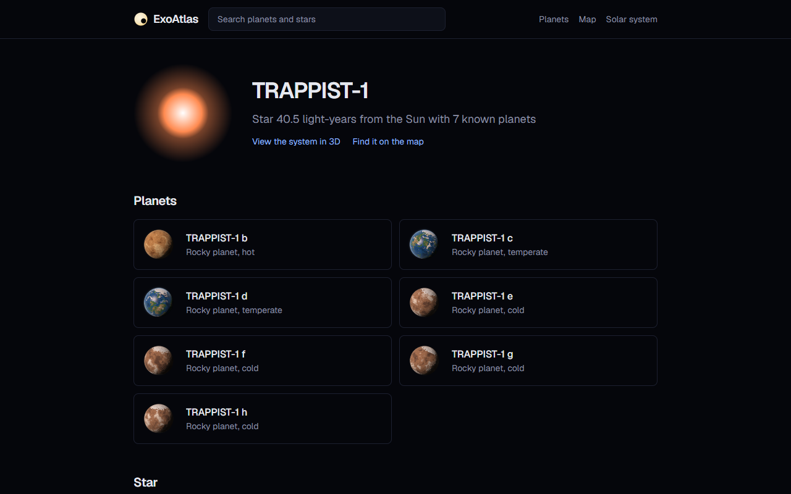

# Star pages

Every star that has known planets has its own page. It shows all of its planets and the most important values of the star.

## Open a star page

You can get there in several ways:

- Search for the star's name. See [Searching](Searching).
- On a [planet page](Planet-Pages), click the star's name below the planet's name, or **More about …** in the section **Host star**.
- On the [map](The-Map), select a star and click **Star page**.

## What the page shows

1. **At the top:** a picture of the star in the colour that matches its temperature, its name, how far away it is and how many planets it has.
2. **View the system in 3D:** opens the [map](The-Map) inside this system. You see the star with all of its planets on their orbits.
3. **Find it on the map:** opens the [map](The-Map) of the Milky Way and flies to the star.
4. **Planets:** one card per planet. Click a card to open the planet's page. Planets that NASA no longer lists appear below, under **No longer listed by NASA**.
5. **Star:** the values of the star. See the table below.
6. **Position:** where the star is in the sky, and its names in other star catalogues.

## The values of the star

| Value | What it means |
| --- | --- |
| **Spectral type** | A code for the kind of star. It starts with a letter: O and B are hot and blue, G is like our Sun, M is small, cool and red. |
| **Temperature** | The temperature of the star's surface in Kelvin. The Sun has about 5,800 K. |
| **Radius** | How wide the star is, compared with the Sun. |
| **Mass** | How heavy the star is, compared with the Sun. |
| **Brightness seen from Earth** | In magnitudes (mag). The smaller the number, the brighter the star. Without a telescope you can see stars down to about 6 mag. |
| **Distance** | In light-years (ly) and parsecs (pc). One light-year is the distance light travels in one year. |
| **Right ascension and declination** | The star's address in the sky, like longitude and latitude on Earth. |

## Good to know

- If the distance of a star is not known, it cannot be shown on the map. The page tells you so.
- A value that has not been measured shows **unknown**.

## Next step

Fly through the Milky Way: [The map](The-Map).
