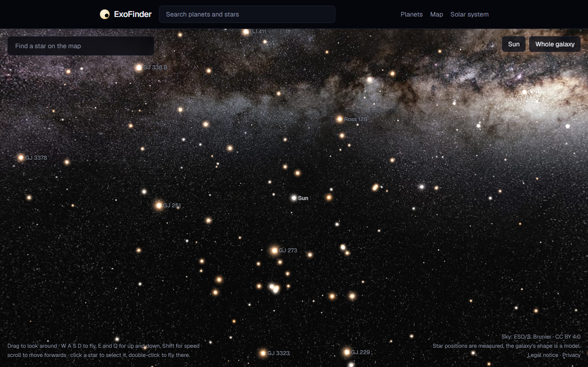
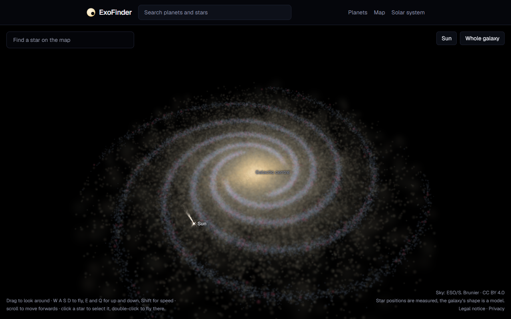
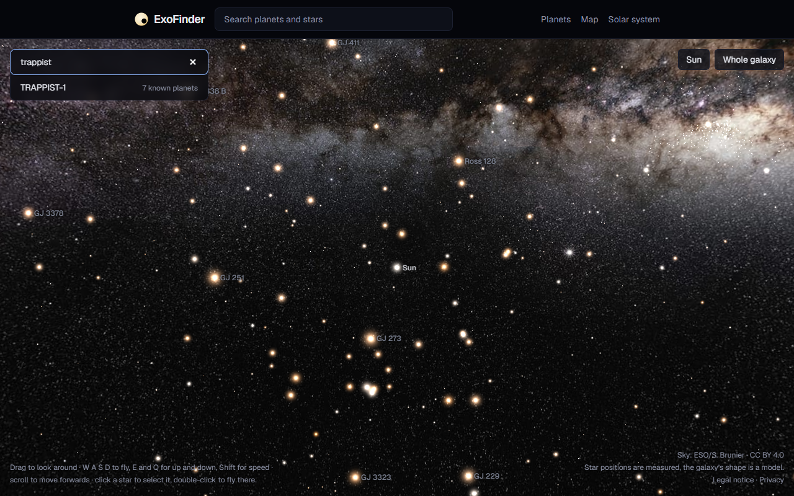
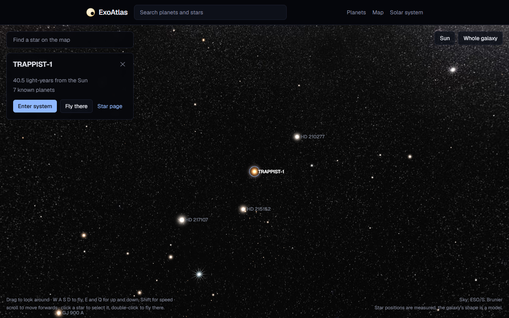
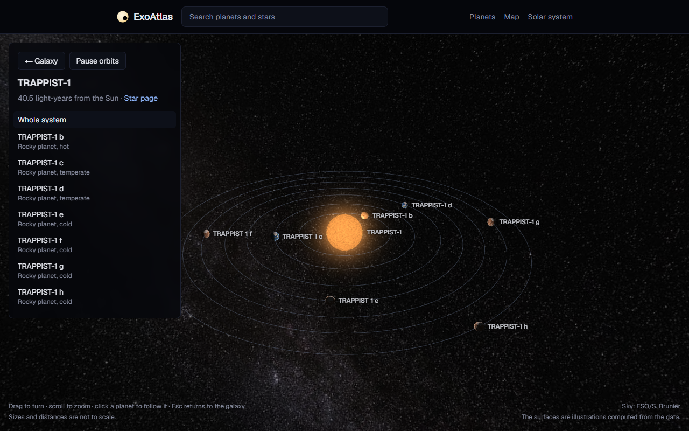

# The map

The map is a 3D model of the Milky Way. Every star with known planets sits at its real position. You can fly from star to star and enter a system to see its planets on their orbits.

The map needs a browser with WebGL 2. All current versions of Chrome, Edge, Firefox and Safari have it.

## Open the map

1. Click **Map** in the bar at the top.
2. The map opens near our Sun. The stars around you are stars with planets. The band of light in the background is the Milky Way, seen from Earth.

## Look around and move

**With a mouse and keyboard**

| To … | do this |
| --- | --- |
| look around | hold the mouse button and drag |
| fly forwards or backwards | turn the mouse wheel |
| fly in any direction | press **W** (forwards), **A** (left), **S** (back), **D** (right) |
| fly up or down | press **E** (up) or **Q** (down) |
| fly faster | hold **Shift** while you fly |

**On a phone or tablet:** drag with one finger to look around, pinch with two fingers to fly.

The buttons in the top right corner bring you to two fixed places:

- **Sun** flies back to our Sun.
- **Whole galaxy** flies far out, so you see the whole Milky Way from above.

The galaxy is an artist's impression, because we cannot look at the Milky Way from outside: Robert Hurt drew it for NASA from what the surveys of its stars and gas show. The positions of the stars are measured.

## Find a star

1. Click into the field **Find a star on the map** in the top left corner.
2. Type a part of the star's name, for example `trappist`.
3. Click the star in the list, or press **Enter** for the first one.
4. The camera flies to the star and selects it.

You can also click a star directly on the map to select it. Double-click it to fly there.

## A selected star

When a star is selected, a box appears in the top left corner. It shows the star's name, its distance from the Sun and how many planets it has.

| Button | What it does |
| --- | --- |
| **Enter system** | Goes inside the system and shows the star with its planets. |
| **Fly there** | Flies to the star, without going inside. |
| **Star page** | Opens the [page of the star](Star-Pages). |
| **✕** | Clears the selection. **Esc** does the same. |

## Inside a system

After **Enter system** you see the star in the middle and its planets on their orbits. The planets move around the star.

1. **Turn the view:** hold the mouse button and drag.
2. **Zoom:** turn the mouse wheel. On a phone, pinch with two fingers.
3. **Follow a planet:** click it on the map or in the list on the left. The camera flies to the planet and stays with it.
4. **Open its page:** click **Page** next to the planet in the list.
5. **See everything again:** click **Whole system** at the top of the list.
6. **Stop the movement:** click **Pause orbits**. Click **Play orbits** to go on.
7. **Leave the system:** click **← Galaxy** or press **Esc**.

On a phone the list of planets is folded away so that it does not cover the view. Tap the button with the planet's name to open it.

> **Not to scale.** In the system view the planets are drawn much bigger than they really are, and the orbits are pushed closer together. Otherwise the planets would be too small to see.

## Jump into the map from other pages

You do not have to search the map yourself. These links take you straight to the right place:

- On a **planet page**: **See it on its orbit in 3D**
- On a **star page**: **View the system in 3D** or **Find it on the map**
